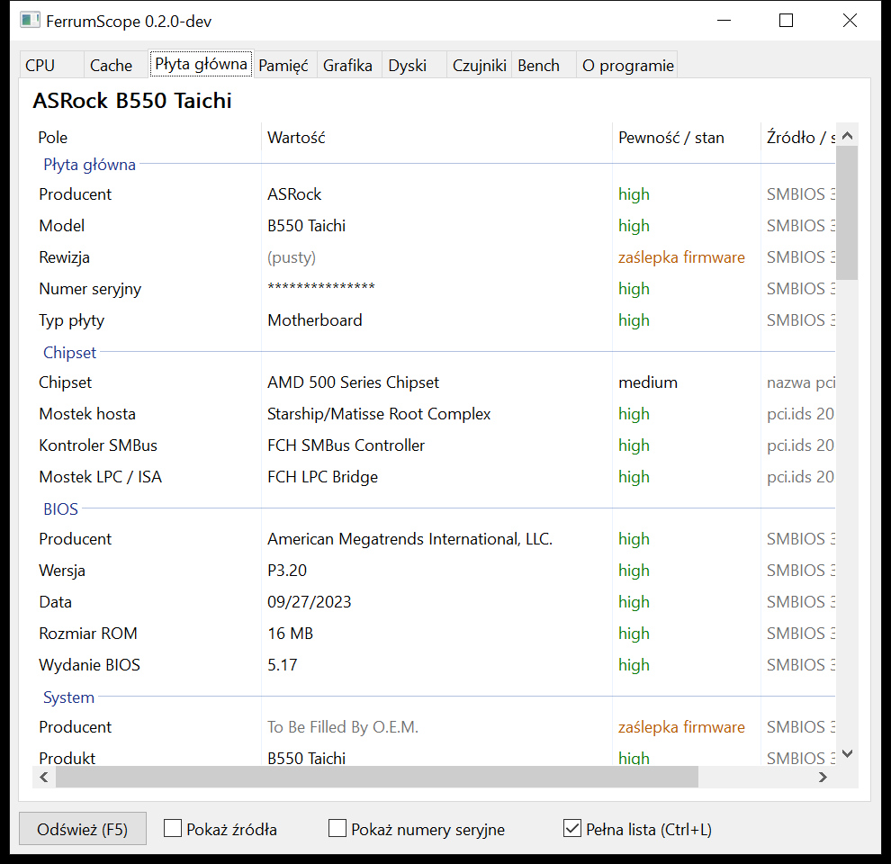

**Езици:** [English](../README.md) · [Polski](README.pl.md) · [Български](README.bg.md) · [Čeština](README.cs.md) · [Dansk](README.da.md) · [Deutsch](README.de.md) · [Ελληνικά](README.el.md) · [Español](README.es.md) · [Eesti](README.et.md) · [Suomi](README.fi.md) · [Français](README.fr.md) · [Hrvatski](README.hr.md) · [Magyar](README.hu.md) · [Italiano](README.it.md) · [Lietuvių](README.lt.md) · [Latviešu](README.lv.md) · [Norsk bokmål](README.nb.md) · [Nederlands](README.nl.md) · [Português (Brasil)](README.pt-BR.md) · [Română](README.ro.md) · [Русский](README.ru.md) · [Slovenčina](README.sk.md) · [Slovenščina](README.sl.md) · [Srpski](README.sr-Latn.md) · [Svenska](README.sv.md) · [Türkçe](README.tr.md) · [Українська](README.uk.md)

# FerrumScope

[](https://github.com/snakex21/FerrumScope/actions/workflows/ci.yml) [](../LICENSE) [](../build.zig.zon) [](#компилиране)

Отворен и прозрачен инструмент за информация за хардуера под Windows — „CPU-Z + GPU-Z в едно“, написан на Zig. Всяка стойност показва **откъде идва** (CPUID лист, SMBIOS отместване, база данни с PCI ID, байт от NVMe лог, библиотека на производителя…) и **колко сигурна** е програмата в нея. За основните функции не е нужен драйвер, няма телеметрия.


## Съдържание

- [Функции](#функции)
- [Екранни снимки](#екранни-снимки)
- [Език на интерфейса](#език-на-интерфейса)
- [Какво изисква драйвер или администраторски права](#какво-изисква-драйвер-или-администраторски-права)
- [Компилиране](#компилиране)
- [GUI](#gui)
- [Команден ред](#команден-ред)
- [Връзки за търсене](#връзки-за-търсене)
- [Актуализации](#актуализации)
- [Capture и replay](#capture-и-replay)
- [Модел на сигурността](#модел-на-сигурността)
- [Източници на данни и лицензи](#източници-на-данни-и-лицензи)

## Функции

- **CPU** — идентификация от CPUID плюс хардуерна база данни с проследим произход (кодово име, микроархитектура, ревизия, сокет), фамилия/модел/степинг, пълният списък с набори инструкции (MMX … AVX-512, AES, SHA, VT-x/AMD-V) с CPUID листа и бита на всяка, изведеното ниво x86-64, кешове, показани като `8 x 32 KB`, топология и оценка на честотата **без драйвер** с натоварване по ядра и общо.
- **Дънна платка** — производител, модел, ревизия и BIOS (SMBIOS типове 0/1/2/3/4), чипсетът, изведен от PCI ID, и всяко PCI устройство, наименувано по вградения `pci.ids`.
- **Памет** — модули от SMBIOS тип 17 (слот, размер, DDR4/DDR5, скорост и конфигурирана скорост, производител, каталожен номер, ранг, напрежение), общият размер и ясно обозначена евристика за каналите.
- **Графика** — DXGI и SetupAPI: имена, ID на производител/устройство/подсистема/ревизия, името на картата от `pci.ids`, версия и дата на драйвера, отделна и споделена памет, PCIe връзката. Честотите, температурите, вентилаторът, натоварването и консумацията идват от **AMD ADL** или **NVIDIA NVAPI**, зареждани по време на работа, само за четене и по избор.
- **Дискове** — модел, фърмуер, шина, размер и сериен номер (маскиран). NVMe лог за състоянието без администраторски права, SATA SMART като администратор: температура, часове на работа, износване и изрично посочено правило за състоянието.
- **Сензори** — натоварване и честота на CPU, сензори на GPU, температури на дисковете. CPU сензори от MSR чрез драйвера по избор; вентилаторите на дънната платка са посочени като *изисква драйвер (планирано)*.
- **Експорт на отчет** — TXT, HTML и JSON. Серийните номера и UUID са **маскирани по подразбиране**.
- **Два изгледа** — компактен изглед в стила на CPU-Z (по подразбиране) и пълен списък с източника и достоверността на всяко поле (`Ctrl+L`).
- **27 езика на интерфейса**, **актуализатор** със стабилен и тестов канал, бутони за **търсене** в базата данни на TechPowerUp и в страниците с драйвери на производителите.

## Екранни снимки

| CPU | Графика |
|---|---|
|  |  |

| Дънна платка | Памет |
|---|---|
|  |  |

| Дискове (администратор, SATA SMART) | Изглед с пълен списък |
|---|---|
|  |  |

Всички раздели и двата изгледа: [docs/screenshots](../docs/screenshots).

## Език на интерфейса

GUI, командният ред и отчетите TXT/HTML са налични на 27 езика: полски (изходен), английски, български, чешки, датски, немски, гръцки, испански, естонски, фински, френски, хърватски, унгарски, италиански, литовски, латвийски, норвежки (букмол), нидерландски, португалски (Бразилия), румънски, руски, словашки, словенски, сръбски (латиница), шведски, турски и украински.

Езикът се избира в този ред: запазената настройка (`data\settings.ini`), езикът на интерфейса на Windows и накрая английски. Може да се промени в GUI (избор на език) или с `ferrumscope lang <code>` / `--lang=<code>`. Техническите стойности (имена на инструкции, мерни единици, PCI ID) никога не се превеждат, а ключовете в JSON експорта остават на английски. За преводачи: вижте [locales/README.md](../locales/README.md).

## Какво изисква драйвер или администраторски права

| Данни | Изискване |
|---|---|
| CPU, дънна платка, памет, графика, състояние на NVMe, дескриптори на дисковете | нищо (обикновен потребител) |
| SATA SMART | стартиране като администратор; без това програмата го съобщава и продължава да работи |
| APERF/MPERF, температури от MSR | драйверът `FerrumScopeMsr.sys` — **не се инсталира автоматично** |
| Вентилатори/напрежения на дънната платка (Super I/O), тайминги от SPD (SMBus) | драйвер на ядрото — **планиран, не е реализиран** |

## Компилиране

Нужен е само фиксираният Zig 0.15.2.

```sh
python tools/fetch_zig.py                         # downloads Zig 0.15.2 and verifies its SHA-256
tools/zig/zig-x86_64-windows-0.15.2/zig build     # zig-out/bin/ferrumscope.exe + ferrumscope-gui.exe
tools/zig/zig-x86_64-windows-0.15.2/zig build test
tools/zig/zig-x86_64-windows-0.15.2/zig build -Doptimize=ReleaseSafe
```

`ferrumscope-gui.bat` компилира и стартира GUI. Драйверът по избор се компилира отделно с WDK (`driver/build_driver.bat`) и никога не се инсталира при компилирането.

## GUI

- Раздели: CPU, Кеш, Дънна платка, Памет, Графика, Дискове, Сензори, Тест (запазено място), Относно.
- Посочете стойност, за да видите източника, достоверността и суровата стойност. **Покажи източници** добавя малък маркер до всяко поле.
- **Пълен списък** (`Ctrl+L`) показва всяко поле с неговия източник; изборът се запомня. `F5` обновява статичните данни (SMBIOS, PCI, дискове).
- **Значка/лого** в разделите CPU и Графика. Приоритет: ваше собствено изображение → вградено лого на производителя → значка, нарисувана от FerrumScope. Поставете собствените си PNG файлове до програмата в `data\images\`:
  - CPU: `cpu\<vendor>-<series>-<model>.png` → `cpu\<vendor>-<series>.png` → `cpu\<vendor>.png` (напр. `cpu\amd-ryzen-7-5800x3d.png`)
  - GPU: `gpu\<vid>-<did>.png` (напр. `gpu\1002-744c.png`) → `gpu\<vendor>-<series>-<model>.png` → `gpu\<vendor>-<series>.png` → `gpu\<vendor>.png`

  Имената са с малки букви, като всеки знак, който не е буква или цифра, се заменя с `-`. Щракването върху значката отваря връзката за търсене.
- Опции на командния ред: `--tab=cpu|caches|board|memory|graphics|storage|sensors|bench|about`, `--list`, `--structured`, `--lang=<code>`.

## Команден ред

```sh
ferrumscope cpu [--json|--raw|--explain]
ferrumscope board | memory | gpu | storage | sensors-all
ferrumscope report --format=html -o report.html           # txt | html | json
ferrumscope report --format=json --include-serials        # serial numbers only on request
ferrumscope report --sys-replay db/fixtures/sys/asrock_b550_5800x3d_rx7900xtx.sysimg \
                   --cpu-replay db/fixtures/amd_ryzen7_5800x3d_native.cpuimg
ferrumscope capture cpu.cpuimg                            # raw CPUID
ferrumscope capture-sys system.sysimg [--include-serials] # raw SMBIOS/PCI/GPU/disks
ferrumscope update --check [--channel=stable|test]
ferrumscope lang [<code>]
ferrumscope sensors                                       # MSR telemetry (needs the driver)
```

## Връзки за търсене

Бутоните **Търси** и значката отварят базата данни на TechPowerUp за GPU/CPU. Когато е известна, се използва точната страница, в този ред:

1. връзка, която сте закачили сами — копирайте адреса на страницата в браузъра и щракнете **Закачи…** до полето (записва се в `data\links.toml`);
2. курираната таблица [`db/source/links/techpowerup.toml`](../db/source/links/techpowerup.toml) — записите се добавят ръчно (`source = "manual"`), никога чрез обхождане на сайтове; pull request-ите са добре дошли;
3. в противен случай търсене по име.

Съхраняват се само връзки; нищо не се изтегля от TechPowerUp. Приемани адреси: `https://` в techpowerup.com или сайта на производителя.

## Актуализации

FerrumScope проверява изданията в GitHub на `snakex21/FerrumScope` през HTTPS — най-много веднъж дневно при стартиране (може да се изключи) или при поискване чрез **Относно → Проверка за актуализации** / `ferrumscope update --check`. Актуализацията се инсталира само след като изтегленият zip съвпадне **и** със SHA-256 в `ferrumscope-update.json`, **и** със `SHA256SUMS`; предишният exe файл се запазва като `.old` (`ferrumscope update --rollback`), а папката `data\` (настройки, закачени връзки, вашите изображения) никога не се променя. Канали: **stable** (по подразбиране) и **test** (предварителни версии). Не се изпраща телеметрия.

## Capture и replay

`.cpuimg` съхранява сурови CPUID листа; `.sysimg` съхранява сурови SMBIOS данни, PCI ID, DXGI адаптери и дескриптори на дисковете/страници NVMe/SMART. И двата са текстови файлове и минават през **същите декодери** като данните на живо, така че парсерите се тестват без хардуер. `capture-sys` по подразбиране маскира серийните номера и SMBIOS UUID (отместванията остават валидни). Формат: [docs/04-fcap-i-testy.md](../docs/04-fcap-i-testy.md).

## Модел на сигурността

- GUI и CLI работят като обикновен потребител; нищо не се инсталира.
- Драйверът по избор `FerrumScopeMsr.sys` е **само за четене**: три IOCTL, **списък с разрешени** MSR (APERF/MPERF), всяка заявка се валидира в ядрото, достъпът до устройството е ограничен до SYSTEM и Administrators (`IoCreateDeviceSecure`), изобщо няма път за запис. Все още не е зареждан на реална система. Подробности: [docs/SECURITY-MODEL.md](../docs/SECURITY-MODEL.md).
- Дисковете получават само команди за четене (IOCTL за заявки към хранилището, NVMe Get Log Page 02h, ATA SMART READ DATA/THRESHOLDS).
- Библиотеките на производителите на GPU се зареждат само от System32 и се използват само функции за заявки.
- Серийните номера са маскирани в GUI, отчетите и capture файловете, освен ако изрично не поискате да се показват.

## Източници на данни и лицензи

- Изходен код на FerrumScope: **GPL-3.0-or-later** ([LICENSE](../LICENSE), [NOTICE.md](../NOTICE.md)).
- `db/source/pci/pci.ids`: PCI ID Repository, GPL-2.0-or-later **или** BSD-3-Clause.
- База данни за CPU (`db/source/cpu/*.toml`): всеки запис посочва своя източник (AMD revision guides, диапазони на модели от ядрото на Linux, публични CPUID дъмпове). Няма данни от CPU-Z или GPU-Z — вижте [reference/README.md](../reference/README.md).
- `assets/logos/` **не** е обхванат от GPL. AMD, Ryzen, Threadripper, EPYC, Radeon, Intel, Core, Xeon, NVIDIA и GeForce са търговски марки на съответните им притежатели; логата се използват само за идентифициране на хардуера и не предполагат одобрение. Произход на всеки файл: [assets/logos/SOURCES.md](../assets/logos/SOURCES.md).
- Връзките към TechPowerUp са обикновени връзки, които отваряте вие; не се изтеглят и не се съхраняват данни от TechPowerUp.
