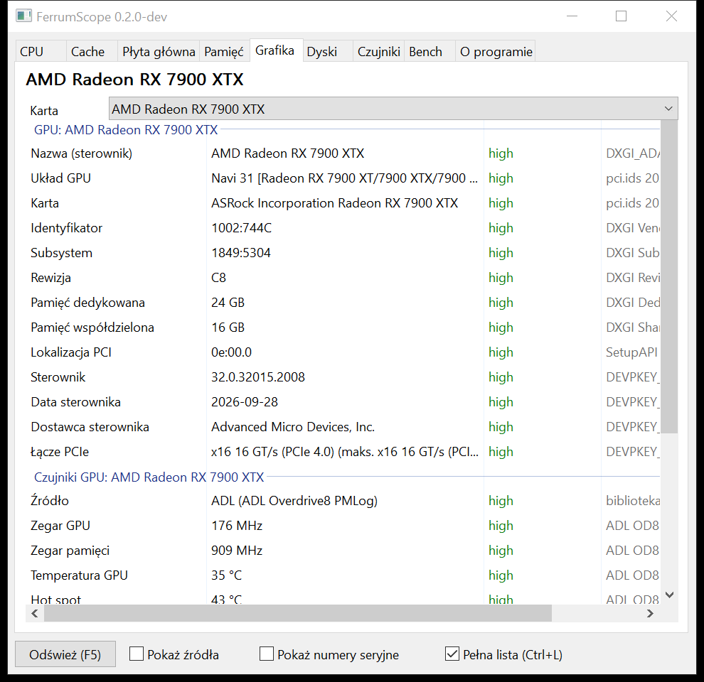

**Jazyky:** [English](../README.md) · [Polski](README.pl.md) · [Български](README.bg.md) · [Čeština](README.cs.md) · [Dansk](README.da.md) · [Deutsch](README.de.md) · [Ελληνικά](README.el.md) · [Español](README.es.md) · [Eesti](README.et.md) · [Suomi](README.fi.md) · [Français](README.fr.md) · [Hrvatski](README.hr.md) · [Magyar](README.hu.md) · [Italiano](README.it.md) · [Lietuvių](README.lt.md) · [Latviešu](README.lv.md) · [Norsk bokmål](README.nb.md) · [Nederlands](README.nl.md) · [Português (Brasil)](README.pt-BR.md) · [Română](README.ro.md) · [Русский](README.ru.md) · [Slovenčina](README.sk.md) · [Slovenščina](README.sl.md) · [Srpski](README.sr-Latn.md) · [Svenska](README.sv.md) · [Türkçe](README.tr.md) · [Українська](README.uk.md)

# FerrumScope

[](https://github.com/snakex21/FerrumScope/actions/workflows/ci.yml) [](../LICENSE) [](../build.zig.zon) [](#sestavení)

Otevřený a transparentní nástroj pro zjišťování informací o hardwaru ve Windows — „CPU-Z + GPU-Z v jednom“, napsaný v jazyce Zig. U každé hodnoty je vidět, **odkud pochází** (list CPUID, offset SMBIOS, databáze PCI ID, bajt logu NVMe, knihovna výrobce…), a **jak spolehlivá** podle programu je. Hlavní funkce nepotřebují ovladač a program neodesílá žádnou telemetrii.


## Obsah

- [Funkce](#funkce)
- [Snímky obrazovky](#snímky-obrazovky)
- [Jazyk rozhraní](#jazyk-rozhraní)
- [Co vyžaduje ovladač nebo práva správce](#co-vyžaduje-ovladač-nebo-práva-správce)
- [Sestavení](#sestavení)
- [GUI](#gui)
- [Příkazový řádek](#příkazový-řádek)
- [Vyhledávací odkazy](#vyhledávací-odkazy)
- [Aktualizace](#aktualizace)
- [Záznam a přehrávání](#záznam-a-přehrávání)
- [Model zabezpečení](#model-zabezpečení)
- [Zdroje dat a licence](#zdroje-dat-a-licence)

## Funkce

- **CPU** — identifikace z CPUID doplněná databází hardwaru se sledovaným původem dat (kódové označení, mikroarchitektura, revize, patice), rodina/model/stepping, úplný seznam instrukčních sad (MMX … AVX-512, AES, SHA, VT-x/AMD-V) s listem a bitem CPUID u každé z nich, odvozená úroveň x86-64, mezipaměti ve tvaru `8 x 32 KB`, topologie a odhad taktu **bez ovladače** se zatížením jednotlivých jader i celkovým.
- **Základní deska** — výrobce, model, revize a BIOS (SMBIOS typy 0/1/2/3/4), čipová sada odvozená z PCI ID a všechna zařízení PCI pojmenovaná podle vestavěného `pci.ids`.
- **Paměť** — moduly ze SMBIOS typu 17 (slot, velikost, DDR4/DDR5, rychlost a nastavená rychlost, výrobce, číslo dílu, rank, napětí), celková velikost a zřetelně označená heuristika kanálů.
- **Grafika** — DXGI a SetupAPI: názvy, ID výrobce/zařízení/subsystému/revize, název karty z `pci.ids`, verze a datum ovladače, vyhrazená a sdílená paměť, linka PCIe. Takty, teploty, ventilátor, zatížení a příkon pocházejí z **AMD ADL** nebo **NVIDIA NVAPI**, které se načítají za běhu, pouze pro čtení a volitelně.
- **Disky** — model, firmware, sběrnice, velikost a sériové číslo (maskované). Log zdraví NVMe bez práv správce, SMART disků SATA při spuštění jako správce: teplota, doba provozu, opotřebení a uvedené pravidlo pro hodnocení zdraví.
- **Senzory** — zatížení a takt CPU, senzory GPU, teploty disků. Senzory CPU založené na MSR přes volitelný ovladač; ventilátory základní desky jsou uvedeny jako *vyžaduje ovladač (plánováno)*.
- **Export sestavy** — TXT, HTML a JSON. Sériová čísla a UUID jsou **ve výchozím stavu maskována**.
- **Dvě zobrazení** — kompaktní zobrazení ve stylu CPU-Z (výchozí) a úplný seznam se zdrojem a spolehlivostí každého pole (`Ctrl+L`).
- **27 jazyků rozhraní**, **aktualizátor** se stabilním a testovacím kanálem, **vyhledávací** tlačítka pro databázi TechPowerUp a stránky ovladačů výrobců.

## Snímky obrazovky

| CPU | Grafika |
|---|---|
|  |  |

| Základní deska | Paměť |
|---|---|
|  |  |

| Disky (správce, SATA SMART) | Zobrazení úplného seznamu |
|---|---|
|  |  |

Všechny karty a obě zobrazení: [docs/screenshots](../docs/screenshots).

## Jazyk rozhraní

GUI, příkazový řádek a sestavy TXT/HTML jsou k dispozici ve 27 jazycích: polština (zdrojový jazyk), angličtina, bulharština, čeština, dánština, němčina, řečtina, španělština, estonština, finština, francouzština, chorvatština, maďarština, italština, litevština, lotyština, norština (bokmål), nizozemština, portugalština (Brazílie), rumunština, ruština, slovenština, slovinština, srbština (latinka), švédština, turečtina a ukrajinština.

Jazyk se volí v tomto pořadí: uložené nastavení (`data\settings.ini`), jazyk zobrazení Windows, poté angličtina. Změnit ho lze v GUI (výběr jazyka) nebo příkazem `ferrumscope lang <code>` / `--lang=<code>`. Technické hodnoty (názvy instrukcí, jednotky, PCI ID) se nikdy nepřekládají a klíče exportu JSON zůstávají anglické. Pro překladatele: viz [locales/README.md](../locales/README.md).

## Co vyžaduje ovladač nebo práva správce

| Data | Požadavek |
|---|---|
| CPU, základní deska, paměť, grafika, zdraví NVMe, deskriptory disků | nic (běžný uživatel) |
| SATA SMART | spuštění jako správce; bez toho to program oznámí a pracuje dál |
| APERF/MPERF, teploty z MSR | ovladač `FerrumScopeMsr.sys` — **neinstaluje se automaticky** |
| Ventilátory/napětí základní desky (Super I/O), časování SPD (SMBus) | ovladač jádra — **plánováno, neimplementováno** |

## Sestavení

Potřebujete pouze připnutou verzi Zig 0.15.2.

```sh
python tools/fetch_zig.py                         # downloads Zig 0.15.2 and verifies its SHA-256
tools/zig/zig-x86_64-windows-0.15.2/zig build     # zig-out/bin/ferrumscope.exe + ferrumscope-gui.exe
tools/zig/zig-x86_64-windows-0.15.2/zig build test
tools/zig/zig-x86_64-windows-0.15.2/zig build -Doptimize=ReleaseSafe
```

`ferrumscope-gui.bat` sestaví a spustí GUI. Volitelný ovladač se sestavuje zvlášť pomocí WDK (`driver/build_driver.bat`) a sestavení ho nikdy neinstaluje.

## GUI

- Karty: CPU, Mezipaměti, Základní deska, Paměť, Grafika, Disky, Senzory, Benchmark (zatím jen rezervované místo), O programu.
- Po najetí myší na hodnotu se zobrazí její zdroj, spolehlivost a surová hodnota. **Zobrazit zdroje** přidá ke každému poli malou značku.
- **Úplný seznam** (`Ctrl+L`) zobrazí každé pole s jeho zdrojem; volba se pamatuje. `F5` obnoví statická data (SMBIOS, PCI, disky).
- **Odznak/logo** na kartách CPU a Grafika. Priorita: váš vlastní obrázek → přibalené logo výrobce → odznak vykreslený FerrumScope. Vlastní soubory PNG umístěte vedle programu do `data\images\`:
  - CPU: `cpu\<vendor>-<series>-<model>.png` → `cpu\<vendor>-<series>.png` → `cpu\<vendor>.png` (např. `cpu\amd-ryzen-7-5800x3d.png`)
  - GPU: `gpu\<vid>-<did>.png` (např. `gpu\1002-744c.png`) → `gpu\<vendor>-<series>-<model>.png` → `gpu\<vendor>-<series>.png` → `gpu\<vendor>.png`

  Názvy jsou malými písmeny a každý znak, který není písmeno ani číslice, je nahrazen znakem `-`. Kliknutím na odznak se otevře vyhledávací odkaz.
- Volby příkazového řádku: `--tab=cpu|caches|board|memory|graphics|storage|sensors|bench|about`, `--list`, `--structured`, `--lang=<code>`.

## Příkazový řádek

```sh
ferrumscope cpu [--json|--raw|--explain]
ferrumscope board | memory | gpu | storage | sensors-all
ferrumscope report --format=html -o report.html           # txt | html | json
ferrumscope report --format=json --include-serials        # serial numbers only on request
ferrumscope report --sys-replay db/fixtures/sys/asrock_b550_5800x3d_rx7900xtx.sysimg \
                   --cpu-replay db/fixtures/amd_ryzen7_5800x3d_native.cpuimg
ferrumscope capture cpu.cpuimg                            # raw CPUID
ferrumscope capture-sys system.sysimg [--include-serials] # raw SMBIOS/PCI/GPU/disks
ferrumscope update --check [--channel=stable|test]
ferrumscope lang [<code>]
ferrumscope sensors                                       # MSR telemetry (needs the driver)
```

## Vyhledávací odkazy

Tlačítka **Vyhledat** a odznak otevírají databázi GPU/CPU na TechPowerUp. Pokud je známa přesná stránka, použije se v tomto pořadí:

1. odkaz, který jste si sami připnuli — zkopírujte adresu stránky v prohlížeči a klikněte na **Připnout…** vedle pole (uloží se do `data\links.toml`);
2. kurátorovaná tabulka [`db/source/links/techpowerup.toml`](../db/source/links/techpowerup.toml) — záznamy se přidávají ručně (`source = "manual"`), nikdy automatickým procházením webu; pull requesty jsou vítány;
3. jinak vyhledávání podle názvu.

Ukládají se pouze odkazy; z TechPowerUp se nic nestahuje. Přijímané adresy: `https://` na techpowerup.com nebo na webu výrobce.

## Aktualizace

FerrumScope kontroluje vydání `snakex21/FerrumScope` na GitHubu přes HTTPS — nejvýše jednou denně při spuštění (lze vypnout) nebo na vyžádání v **O programu → Zkontrolovat aktualizace…** / `ferrumscope update --check`. Aktualizace se nainstaluje teprve tehdy, když stažený zip odpovídá **jak** součtu SHA-256 v `ferrumscope-update.json`, **tak** `SHA256SUMS`; předchozí exe se ponechá jako `.old` (`ferrumscope update --rollback`) a složky `data\` (nastavení, připnuté odkazy, vaše obrázky) se aktualizace nikdy nedotkne. Kanály: **stable** (stabilní, výchozí) a **test** (testovací, předběžné verze). Neodesílá se žádná telemetrie.

## Záznam a přehrávání

`.cpuimg` uchovává surové listy CPUID; `.sysimg` uchovává surová data SMBIOS, PCI ID, adaptéry DXGI a deskriptory disků/stránky NVMe/SMART. Oba jsou textové soubory a procházejí **stejnými dekodéry** jako data za běhu, takže parsery lze testovat bez hardwaru. `capture-sys` ve výchozím stavu maskuje sériová čísla a UUID ze SMBIOS (offsety zůstávají platné). Formát: [docs/04-fcap-i-testy.md](../docs/04-fcap-i-testy.md).

## Model zabezpečení

- GUI i CLI běží pod běžným uživatelem; nic se neinstaluje.
- Volitelný ovladač `FerrumScopeMsr.sys` je **pouze pro čtení**: tři IOCTL, **seznam povolených** MSR (APERF/MPERF), každý požadavek se ověřuje v jádře, přístup k zařízení je omezen na SYSTEM a Administrators (`IoCreateDeviceSecure`) a neexistuje vůbec žádná cesta pro zápis. Na skutečném systému zatím načten nebyl. Podrobnosti: [docs/SECURITY-MODEL.md](../docs/SECURITY-MODEL.md).
- Disky dostávají pouze příkazy pro čtení (IOCTL dotazů na úložiště, NVMe Get Log Page 02h, ATA SMART READ DATA/THRESHOLDS).
- Knihovny GPU výrobců se načítají pouze ze System32 a používají se jen dotazovací funkce.
- Sériová čísla jsou v GUI, sestavách i záznamech maskována, pokud o ně výslovně nepožádáte.

## Zdroje dat a licence

- Zdrojový kód FerrumScope: **GPL-3.0-or-later** ([LICENSE](../LICENSE), [NOTICE.md](../NOTICE.md)).
- `db/source/pci/pci.ids`: PCI ID Repository, GPL-2.0-or-later **nebo** BSD-3-Clause.
- Databáze CPU (`db/source/cpu/*.toml`): každý záznam uvádí svůj zdroj (revizní příručky AMD, rozsahy modelů z jádra Linuxu, veřejné výpisy CPUID). Žádná data z CPU-Z ani GPU-Z — viz [reference/README.md](../reference/README.md).
- Na `assets/logos/` se GPL **nevztahuje**. AMD, Ryzen, Threadripper, EPYC, Radeon, Intel, Core, Xeon, NVIDIA a GeForce jsou ochranné známky příslušných vlastníků; loga se používají pouze k identifikaci hardwaru a neznamenají žádnou podporu ani doporučení. Původ jednotlivých souborů: [assets/logos/SOURCES.md](../assets/logos/SOURCES.md).
- Odkazy na TechPowerUp jsou obyčejné odkazy, které otevíráte vy; žádná data z TechPowerUp se nestahují ani neukládají.
