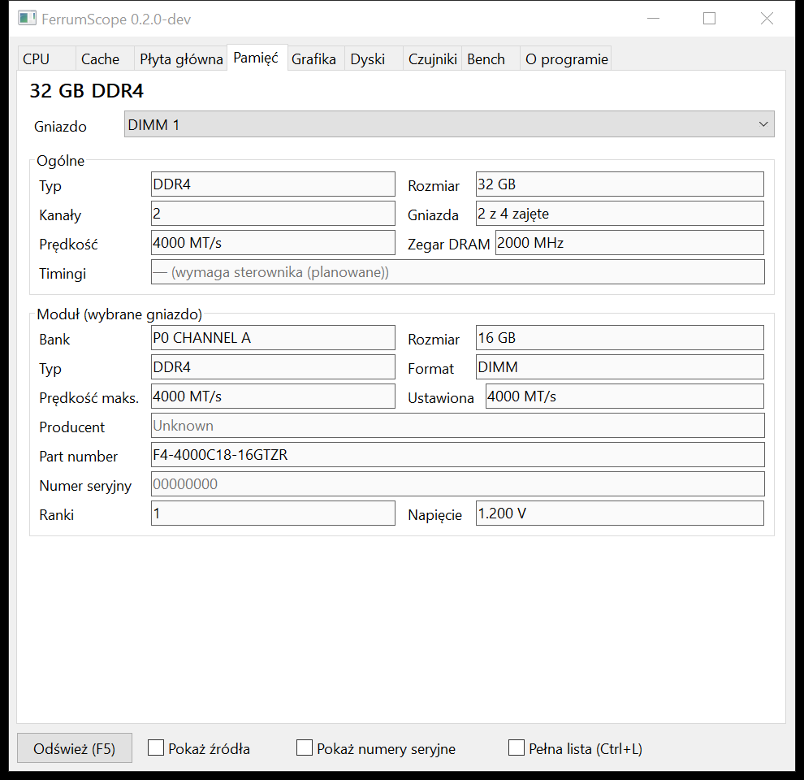
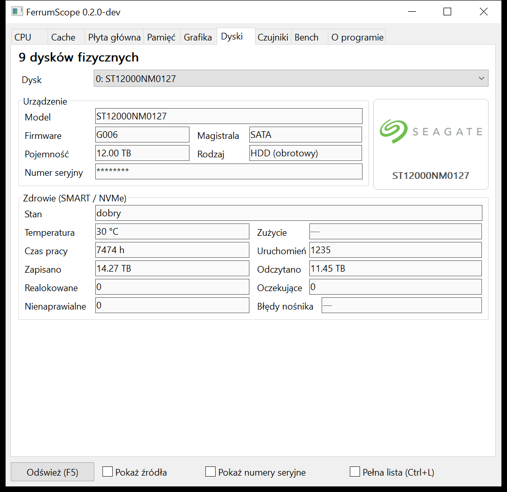

**Languages:** [English](../README.md) · [Polski](README.pl.md) · [Български](README.bg.md) · [Čeština](README.cs.md) · [Dansk](README.da.md) · [Deutsch](README.de.md) · [Ελληνικά](README.el.md) · [Español](README.es.md) · [Eesti](README.et.md) · [Suomi](README.fi.md) · [Français](README.fr.md) · [Hrvatski](README.hr.md) · [Magyar](README.hu.md) · [Italiano](README.it.md) · [Lietuvių](README.lt.md) · [Latviešu](README.lv.md) · [Norsk bokmål](README.nb.md) · [Nederlands](README.nl.md) · [Português (Brasil)](README.pt-BR.md) · [Română](README.ro.md) · [Русский](README.ru.md) · [Slovenčina](README.sk.md) · [Slovenščina](README.sl.md) · [Srpski](README.sr-Latn.md) · [Svenska](README.sv.md) · [Türkçe](README.tr.md) · [Українська](README.uk.md)

# FerrumScope

[](https://github.com/snakex21/FerrumScope/actions/workflows/ci.yml) [](../LICENSE) [](../build.zig.zon) [](#kääntäminen)

Avoin ja läpinäkyvä laitteiston tietotyökalu Windowsille — ”CPU-Z + GPU-Z yhdessä”, kirjoitettu Zigillä. Jokaisesta arvosta näytetään, **mistä se on peräisin** (CPUID-lehti, SMBIOS-siirtymä, PCI ID -tietokanta, NVMe-lokin tavu, valmistajan kirjasto…) ja **kuinka varma** ohjelma siitä on. Pääominaisuudet eivät tarvitse ajuria, eikä telemetriaa ole.


## Sisältö

- [Ominaisuudet](#ominaisuudet)
- [Kuvakaappaukset](#kuvakaappaukset)
- [Käyttöliittymän kieli](#käyttöliittymän-kieli)
- [Mikä vaatii ajurin tai järjestelmänvalvojan oikeudet](#mikä-vaatii-ajurin-tai-järjestelmänvalvojan-oikeudet)
- [Kääntäminen](#kääntäminen)
- [GUI](#gui)
- [Komentorivi](#komentorivi)
- [Hakulinkit](#hakulinkit)
- [Päivitykset](#päivitykset)
- [Tallennus ja toisto](#tallennus-ja-toisto)
- [Tietoturvamalli](#tietoturvamalli)
- [Tietolähteet ja lisenssit](#tietolähteet-ja-lisenssit)

## Ominaisuudet

- **CPU** — tunnistus CPUID:sta sekä laitteistotietokannasta, jonka jokaisen merkinnän alkuperä on jäljitettävissä (koodinimi, mikroarkkitehtuuri, revisio, kanta), perhe/malli/stepping, täydellinen käskykantaluettelo (MMX … AVX-512, AES, SHA, VT-x/AMD-V) kunkin CPUID-lehden ja -bitin kanssa, johdettu x86-64-taso, välimuistit muodossa `8 x 32 KB`, topologia sekä **ajuriton** kellotaajuusarvio ydinkohtaisella ja kokonaiskuormalla.
- **Emolevy** — valmistaja, malli, revisio ja BIOS (SMBIOS-tyypit 0/1/2/3/4), PCI-tunnisteista johdettu piirisarja sekä jokainen PCI-laite nimettynä sisäänrakennetusta `pci.ids`-tiedostosta.
- **Muisti** — moduulit SMBIOS-tyypistä 17 (paikka, koko, DDR4/DDR5, nopeus ja määritetty nopeus, valmistaja, osanumero, rank, jännite), kokonaiskoko sekä selvästi merkitty kanavaheuristiikka.
- **Grafiikka** — DXGI ja SetupAPI: nimet, vendor/device/subsystem/revision-tunnisteet, kortin nimi `pci.ids`-tiedostosta, ajurin versio ja päiväys, oma ja jaettu muisti, PCIe-linkki. Kellot, lämpötilat, tuuletin, kuorma ja teho tulevat **AMD ADL**:stä tai **NVIDIA NVAPI**:sta, jotka ladataan ajon aikana, vain luku -tilassa ja valinnaisina.
- **Tallennus** — malli, laiteohjelmisto, väylä, koko ja sarjanumero (peitetty). NVMe-kuntoloki ilman järjestelmänvalvojan oikeuksia, SATA SMART järjestelmänvalvojana: lämpötila, käyttötunnit, kuluminen ja ilmoitettu kuntosääntö.
- **Anturit** — CPU:n kuorma ja kellotaajuus, GPU-anturit, levyjen lämpötilat. MSR-pohjaiset CPU-anturit valinnaisen ajurin kautta; emolevyn tuulettimet on merkitty tilaan *vaatii ajurin (suunnitteilla)*.
- **Raportin vienti** — TXT, HTML ja JSON. Sarjanumerot ja UUID:t ovat **oletuksena peitettyjä**.
- **Kaksi näkymää** — tiivis CPU-Z-tyylinen näkymä (oletus) ja täysi luettelo, jossa näkyy jokaisen kentän lähde ja luotettavuus (`Ctrl+L`).
- **27 käyttöliittymäkieltä**, **päivittäjä** vakaalla ja testikanavalla sekä **hakupainikkeet** TechPowerUp-tietokantaan ja valmistajien ajurisivuille.

## Kuvakaappaukset

| CPU | Grafiikka |
|---|---|
|  |  |

| Emolevy | Muisti |
|---|---|
|  |  |

| Tallennus (järjestelmänvalvoja, SATA SMART) | Täysi luettelonäkymä |
|---|---|
|  |  |

Kaikki välilehdet ja molemmat näkymät: [docs/screenshots](../docs/screenshots).

## Käyttöliittymän kieli

GUI, komentorivi ja TXT/HTML-raportit ovat saatavilla 27 kielellä: puola (lähdekieli), englanti, bulgaria, tšekki, tanska, saksa, kreikka, espanja, viro, suomi, ranska, kroatia, unkari, italia, liettua, latvia, norja (bokmål), hollanti, portugali (Brasilia), romania, venäjä, slovakki, sloveeni, serbia (latinalainen), ruotsi, turkki ja ukraina.

Kieli valitaan tässä järjestyksessä: tallennettu asetus (`data\settings.ini`), Windowsin näyttökieli ja lopuksi englanti. Kielen voi vaihtaa GUI:ssa (kielivalitsin) tai komennolla `ferrumscope lang <code>` / `--lang=<code>`. Teknisiä arvoja (käskyjen nimiä, yksiköitä, PCI-tunnisteita) ei koskaan käännetä, ja JSON-viennin avaimet pysyvät englanninkielisinä. Kääntäjille: katso [locales/README.md](../locales/README.md).

## Mikä vaatii ajurin tai järjestelmänvalvojan oikeudet

| Tiedot | Vaatimus |
|---|---|
| CPU, emolevy, muisti, grafiikka, NVMe-kunto, levyjen kuvaajat | ei mitään (tavallinen käyttäjä) |
| SATA SMART | suoritus järjestelmänvalvojana; ilman sitä ohjelma kertoo asiasta ja toimii edelleen |
| APERF/MPERF, lämpötilat MSR:stä | `FerrumScopeMsr.sys`-ajuri — **ei asennu automaattisesti** |
| Emolevyn tuulettimet/jännitteet (Super I/O), SPD-ajoitukset (SMBus) | ydinajuri — **suunnitteilla, ei toteutettu** |

## Kääntäminen

Tarvitaan vain kiinnitetty Zig 0.15.2.

```sh
python tools/fetch_zig.py                         # downloads Zig 0.15.2 and verifies its SHA-256
tools/zig/zig-x86_64-windows-0.15.2/zig build     # zig-out/bin/ferrumscope.exe + ferrumscope-gui.exe
tools/zig/zig-x86_64-windows-0.15.2/zig build test
tools/zig/zig-x86_64-windows-0.15.2/zig build -Doptimize=ReleaseSafe
```

`ferrumscope-gui.bat` kääntää ja käynnistää GUI:n. Valinnainen ajuri käännetään erikseen WDK:lla (`driver/build_driver.bat`), eikä kääntäminen koskaan asenna sitä.

## GUI

- Välilehdet: CPU, Välimuisti, Emolevy, Muisti, Grafiikka, Tallennus, Anturit, Testi (paikkamerkki), Tietoja.
- Vie osoitin arvon päälle nähdäksesi sen lähteen, luotettavuuden ja raaka-arvon. **Näytä lähteet** lisää pienen merkin jokaisen kentän viereen.
- **Täysi luettelo** (`Ctrl+L`) näyttää jokaisen kentän lähteineen; valinta muistetaan. `F5` päivittää staattiset tiedot (SMBIOS, PCI, levyt).
- **Merkki/logo** CPU- ja Grafiikka-välilehdillä. Järjestys: oma kuvasi → ohjelman mukana tuleva valmistajan logo → FerrumScopen piirtämä merkki. Laita omat PNG-tiedostosi ohjelman viereen kansioon `data\images\`:
  - CPU: `cpu\<vendor>-<series>-<model>.png` → `cpu\<vendor>-<series>.png` → `cpu\<vendor>.png` (esim. `cpu\amd-ryzen-7-5800x3d.png`)
  - GPU: `gpu\<vid>-<did>.png` (esim. `gpu\1002-744c.png`) → `gpu\<vendor>-<series>-<model>.png` → `gpu\<vendor>-<series>.png` → `gpu\<vendor>.png`

  Nimet kirjoitetaan pienillä kirjaimilla, ja jokainen muu kuin aakkosnumeerinen merkki korvataan merkillä `-`. Merkin napsauttaminen avaa hakulinkin.
- Komentorivivalinnat: `--tab=cpu|caches|board|memory|graphics|storage|sensors|bench|about`, `--list`, `--structured`, `--lang=<code>`.

## Komentorivi

```sh
ferrumscope cpu [--json|--raw|--explain]
ferrumscope board | memory | gpu | storage | sensors-all
ferrumscope report --format=html -o report.html           # txt | html | json
ferrumscope report --format=json --include-serials        # serial numbers only on request
ferrumscope report --sys-replay db/fixtures/sys/asrock_b550_5800x3d_rx7900xtx.sysimg \
                   --cpu-replay db/fixtures/amd_ryzen7_5800x3d_native.cpuimg
ferrumscope capture cpu.cpuimg                            # raw CPUID
ferrumscope capture-sys system.sysimg [--include-serials] # raw SMBIOS/PCI/GPU/disks
ferrumscope update --check [--channel=stable|test]
ferrumscope lang [<code>]
ferrumscope sensors                                       # MSR telemetry (needs the driver)
```

## Hakulinkit

**Hae**-painikkeet ja merkki avaavat TechPowerUpin GPU/CPU-tietokannan. Tarkkaa sivua käytetään, kun se tiedetään, tässä järjestyksessä:

1. itse kiinnittämäsi linkki — kopioi sivun osoite selaimesta ja napsauta kentän vieressä **Kiinnitä…** (tallennetaan tiedostoon `data\links.toml`);
2. ylläpidetty taulukko [`db/source/links/techpowerup.toml`](../db/source/links/techpowerup.toml) — merkinnät lisätään käsin (`source = "manual"`), ei koskaan indeksoimalla; pull requestit ovat tervetulleita;
3. muuten haku nimellä.

Vain linkit tallennetaan; TechPowerUpista ei ladata mitään. Hyväksytyt osoitteet: `https://` sivustolla techpowerup.com tai valmistajan sivustolla.

## Päivitykset

FerrumScope tarkistaa projektin `snakex21/FerrumScope` GitHub-julkaisut HTTPS:n kautta — enintään kerran päivässä käynnistyksen yhteydessä (voidaan poistaa käytöstä) tai pyynnöstä kohdassa **Tietoja → Tarkista päivitykset** / `ferrumscope update --check`. Päivitys asennetaan vasta, kun ladattu zip vastaa **sekä** tiedoston `ferrumscope-update.json` että `SHA256SUMS`:n SHA-256-summaa; edellinen exe säilytetään nimellä `.old` (`ferrumscope update --rollback`), eikä `data\`-kansioon (asetukset, kiinnitetyt linkit, omat kuvasi) kosketa koskaan. Kanavat: **stable** (oletus) ja **test** (esiversiot). Telemetriaa ei lähetetä.

## Tallennus ja toisto

`.cpuimg` tallentaa raa'at CPUID-lehdet; `.sysimg` tallentaa raa'at SMBIOS-tiedot, PCI-tunnisteet, DXGI-sovittimet sekä levyjen kuvaajat ja NVMe/SMART-sivut. Molemmat ovat tekstitiedostoja ja kulkevat **samojen dekooderien** läpi kuin reaaliaikaiset tiedot, joten jäsentimiä testataan ilman laitteistoa. `capture-sys` peittää oletuksena sarjanumerot ja SMBIOS-UUID:n (siirtymät pysyvät kelvollisina). Muoto: [docs/04-fcap-i-testy.md](../docs/04-fcap-i-testy.md).

## Tietoturvamalli

- GUI ja CLI toimivat tavallisena käyttäjänä; mitään ei asenneta.
- Valinnainen `FerrumScopeMsr.sys`-ajuri on **vain luku**: kolme IOCTL:ää, MSR-**sallittujen luettelo** (APERF/MPERF), jokainen pyyntö tarkistetaan ytimessä, laitteen käyttö on rajattu SYSTEMille ja järjestelmänvalvojille (`IoCreateDeviceSecure`), eikä kirjoituspolkua ole lainkaan. Sitä ei ole vielä ladattu oikeaan järjestelmään. Lisätietoja: [docs/SECURITY-MODEL.md](../docs/SECURITY-MODEL.md).
- Levyille lähetetään vain lukukomentoja (tallennuskyselyjen IOCTL:t, NVMe Get Log Page 02h, ATA SMART READ DATA/THRESHOLDS).
- Valmistajien GPU-kirjastot ladataan vain System32:sta, ja niistä käytetään vain kyselyfunktioita.
- Sarjanumerot peitetään GUI:ssa, raporteissa ja tallennuksissa, ellet nimenomaisesti pyydä niitä.

## Tietolähteet ja lisenssit

- FerrumScopen lähdekoodi: **GPL-3.0-or-later** ([LICENSE](../LICENSE), [NOTICE.md](../NOTICE.md)).
- `db/source/pci/pci.ids`: PCI ID Repository, GPL-2.0-or-later **tai** BSD-3-Clause.
- CPU-tietokanta (`db/source/cpu/*.toml`): jokainen merkintä mainitsee lähteensä (AMD:n revisio-oppaat, Linux-ytimen malliväli, julkiset CPUID-vedokset). Ei tietoja CPU-Z:sta tai GPU-Z:sta — katso [reference/README.md](../reference/README.md).
- `assets/logos/` **ei** kuulu GPL:n piiriin. AMD, Ryzen, Threadripper, EPYC, Radeon, Intel, Core, Xeon, NVIDIA ja GeForce ovat omistajiensa tavaramerkkejä; logoja käytetään vain laitteiston tunnistamiseen, eikä niiden käyttö merkitse kannatusta. Tiedostokohtainen alkuperä: [assets/logos/SOURCES.md](../assets/logos/SOURCES.md).
- TechPowerUp-linkit ovat tavallisia linkkejä, jotka sinä avaat; TechPowerUpin tietoja ei ladata eikä tallenneta.
