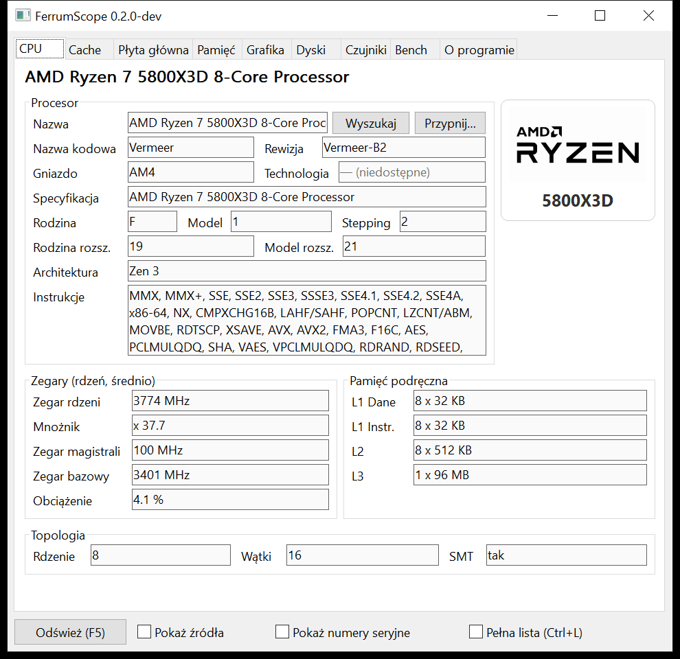

**Languages:** [English](../README.md) · [Polski](README.pl.md) · [Български](README.bg.md) · [Čeština](README.cs.md) · [Dansk](README.da.md) · [Deutsch](README.de.md) · [Ελληνικά](README.el.md) · [Español](README.es.md) · [Eesti](README.et.md) · [Suomi](README.fi.md) · [Français](README.fr.md) · [Hrvatski](README.hr.md) · [Magyar](README.hu.md) · [Italiano](README.it.md) · [Lietuvių](README.lt.md) · [Latviešu](README.lv.md) · [Norsk bokmål](README.nb.md) · [Nederlands](README.nl.md) · [Português (Brasil)](README.pt-BR.md) · [Română](README.ro.md) · [Русский](README.ru.md) · [Slovenčina](README.sk.md) · [Slovenščina](README.sl.md) · [Srpski](README.sr-Latn.md) · [Svenska](README.sv.md) · [Türkçe](README.tr.md) · [Українська](README.uk.md)

# FerrumScope

[](https://github.com/snakex21/FerrumScope/actions/workflows/ci.yml) [](../LICENSE) [](../build.zig.zon) [](#izgradnja)

Otvoreni, transparentni alat za informacije o hardveru za Windows — „CPU-Z + GPU-Z u jednom”, napisan u Zigu. Uz svaku vrijednost prikazuje se **odakle potječe** (CPUID list, SMBIOS pomak, baza PCI ID-ova, bajt NVMe loga, biblioteka proizvođača…) i **koliko je program siguran** u nju. Za glavne značajke nije potreban upravljački program, a nema ni telemetrije.



## Sadržaj

- [Značajke](#značajke)
- [Snimke zaslona](#snimke-zaslona)
- [Jezik sučelja](#jezik-sučelja)
- [Što zahtijeva upravljački program ili administratorska prava](#što-zahtijeva-upravljački-program-ili-administratorska-prava)
- [Izgradnja](#izgradnja)
- [GUI](#gui)
- [Naredbeni redak](#naredbeni-redak)
- [Poveznice za pretraživanje](#poveznice-za-pretraživanje)
- [Ažuriranja](#ažuriranja)
- [Snimanje i reprodukcija](#snimanje-i-reprodukcija)
- [Sigurnosni model](#sigurnosni-model)
- [Izvori podataka i licence](#izvori-podataka-i-licence)

## Značajke

- **CPU** — identifikacija iz CPUID-a uz hardversku bazu s praćenim podrijetlom podataka (kodni naziv, mikroarhitektura, revizija, podnožje), obitelj/model/stepping, potpuni popis skupova instrukcija (MMX … AVX-512, AES, SHA, VT-x/AMD-V) s CPUID listom i bitom za svaku, izvedena razina x86-64, predmemorija prikazana kao `8 x 32 KB`, topologija te procjena takta **bez upravljačkog programa** s opterećenjem po jezgri i ukupnim opterećenjem.
- **Matična ploča** — proizvođač, model, revizija i BIOS (SMBIOS tipovi 0/1/2/3/4), skup čipova izveden iz PCI ID-ova te svaki PCI uređaj imenovan prema ugrađenoj datoteci `pci.ids`.
- **Memorija** — moduli iz SMBIOS tipa 17 (utor, veličina, DDR4/DDR5, brzina i konfigurirana brzina, proizvođač, broj dijela, rank, napon), ukupna veličina i jasno označena heuristika kanala.
- **Grafika** — DXGI i SetupAPI: nazivi, ID-ovi proizvođača/uređaja/podsustava/revizije, naziv kartice iz `pci.ids`, verzija i datum upravljačkog programa, namjenska i dijeljena memorija, PCIe veza. Taktovi, temperature, ventilator, opterećenje i snaga dolaze iz **AMD ADL** ili **NVIDIA NVAPI**, koji se učitavaju tijekom izvođenja, samo za čitanje i neobavezno.
- **Diskovi** — model, firmver, sabirnica, veličina i serijski broj (maskiran). NVMe log zdravlja bez administratorskih prava, SATA SMART kao administrator: temperatura, sati rada, istrošenost i navedeno pravilo procjene zdravlja.
- **Senzori** — opterećenje i takt CPU-a, senzori GPU-a, temperature diskova. Senzori CPU-a temeljeni na MSR-ovima putem neobaveznog upravljačkog programa; ventilatori matične ploče navedeni su kao *zahtijeva upravljački program (planirano)*.
- **Izvoz izvještaja** — TXT, HTML i JSON. Serijski brojevi i UUID-ovi **zadano su maskirani**.
- **Dva prikaza** — kompaktan prikaz u stilu CPU-Z-a (zadano) i puni popis s izvorom i pouzdanošću svakog polja (`Ctrl+L`).
- **27 jezika sučelja**, **alat za ažuriranje** sa stabilnim i testnim kanalom, gumbi za **pretraživanje** baze TechPowerUp i stranica s upravljačkim programima proizvođača.

## Snimke zaslona

| CPU | Grafika |
|---|---|
|  |  |

| Matična ploča | Memorija |
|---|---|
|  |  |

| Diskovi (administrator, SATA SMART) | Prikaz punog popisa |
|---|---|
|  |  |

Sve kartice i oba prikaza: [docs/screenshots](../docs/screenshots).

## Jezik sučelja

GUI, naredbeni redak i TXT/HTML izvještaji dostupni su na 27 jezika: poljskom (izvorni), engleskom, bugarskom, češkom, danskom, njemačkom, grčkom, španjolskom, estonskom, finskom, francuskom, hrvatskom, mađarskom, talijanskom, litavskom, latvijskom, norveškom (bokmål), nizozemskom, portugalskom (Brazil), rumunjskom, ruskom, slovačkom, slovenskom, srpskom (latinica), švedskom, turskom i ukrajinskom.

Jezik se odabire ovim redoslijedom: spremljena postavka (`data\settings.ini`), jezik prikaza sustava Windows, zatim engleski. Promijenite ga u GUI-ju (odabir jezika) ili naredbom `ferrumscope lang <code>` / `--lang=<code>`. Tehničke vrijednosti (nazivi instrukcija, jedinice, PCI ID-ovi) nikad se ne prevode, a ključevi JSON izvoza ostaju na engleskom. Prevoditelji: pogledajte [locales/README.md](../locales/README.md).

## Što zahtijeva upravljački program ili administratorska prava

| Podaci | Zahtjev |
|---|---|
| CPU, matična ploča, memorija, grafika, zdravlje NVMe-a, opisnici diskova | ništa (običan korisnik) |
| SATA SMART | pokretanje kao administrator; bez toga program to javlja i nastavlja raditi |
| APERF/MPERF, temperature iz MSR-ova | upravljački program `FerrumScopeMsr.sys` — **ne instalira se automatski** |
| Ventilatori/naponi matične ploče (Super I/O), SPD vremenski parametri (SMBus) | upravljački program jezgre — **planirano, nije implementirano** |

## Izgradnja

Potreban je samo fiksirani Zig 0.15.2.

```sh
python tools/fetch_zig.py                         # downloads Zig 0.15.2 and verifies its SHA-256
tools/zig/zig-x86_64-windows-0.15.2/zig build     # zig-out/bin/ferrumscope.exe + ferrumscope-gui.exe
tools/zig/zig-x86_64-windows-0.15.2/zig build test
tools/zig/zig-x86_64-windows-0.15.2/zig build -Doptimize=ReleaseSafe
```

`ferrumscope-gui.bat` izgrađuje i pokreće GUI. Neobavezni upravljački program izgrađuje se zasebno pomoću WDK-a (`driver/build_driver.bat`) i izgradnja ga nikad ne instalira.

## GUI

- Kartice: CPU, Predmemorija, Matična ploča, Memorija, Grafika, Diskovi, Senzori, Test (rezervirano mjesto), O programu.
- Postavite pokazivač na vrijednost da biste vidjeli njezin izvor, pouzdanost i sirovu vrijednost. **Prikaži izvore** dodaje malu oznaku pokraj svakog polja.
- **Puni popis** (`Ctrl+L`) prikazuje svako polje s njegovim izvorom; odabir se pamti. `F5` osvježava statične podatke (SMBIOS, PCI, diskovi).
- **Značka/logotip** na karticama CPU i Grafika. Prioritet: vaša vlastita slika → priloženi logotip proizvođača → značka koju crta FerrumScope. Vlastite PNG datoteke stavite pokraj programa u `data\images\`:
  - CPU: `cpu\<vendor>-<series>-<model>.png` → `cpu\<vendor>-<series>.png` → `cpu\<vendor>.png` (npr. `cpu\amd-ryzen-7-5800x3d.png`)
  - GPU: `gpu\<vid>-<did>.png` (npr. `gpu\1002-744c.png`) → `gpu\<vendor>-<series>-<model>.png` → `gpu\<vendor>-<series>.png` → `gpu\<vendor>.png`

  Nazivi su malim slovima, a svaki znak koji nije slovo ili znamenka zamjenjuje se s `-`. Klik na značku otvara poveznicu za pretraživanje.
- Opcije naredbenog retka: `--tab=cpu|caches|board|memory|graphics|storage|sensors|bench|about`, `--list`, `--structured`, `--lang=<code>`.

## Naredbeni redak

```sh
ferrumscope cpu [--json|--raw|--explain]
ferrumscope board | memory | gpu | storage | sensors-all
ferrumscope report --format=html -o report.html           # txt | html | json
ferrumscope report --format=json --include-serials        # serial numbers only on request
ferrumscope report --sys-replay db/fixtures/sys/asrock_b550_5800x3d_rx7900xtx.sysimg \
                   --cpu-replay db/fixtures/amd_ryzen7_5800x3d_native.cpuimg
ferrumscope capture cpu.cpuimg                            # raw CPUID
ferrumscope capture-sys system.sysimg [--include-serials] # raw SMBIOS/PCI/GPU/disks
ferrumscope update --check [--channel=stable|test]
ferrumscope lang [<code>]
ferrumscope sensors                                       # MSR telemetry (needs the driver)
```

## Poveznice za pretraživanje

Gumbi **Potraži** i značka otvaraju bazu GPU-ova/CPU-ova TechPowerUp. Točna stranica koristi se kada je poznata, ovim redoslijedom:

1. poveznica koju ste sami prikvačili — kopirajte adresu stranice u pregledniku i kliknite **Prikvači…** pokraj polja (sprema se u `data\links.toml`);
2. kurirana tablica [`db/source/links/techpowerup.toml`](../db/source/links/techpowerup.toml) — unosi se dodaju ručno (`source = "manual"`), nikad automatskim prikupljanjem; zahtjevi za povlačenje (pull requests) su dobrodošli;
3. inače pretraživanje po nazivu.

Pohranjuju se samo poveznice; ništa se ne preuzima s TechPowerUpa. Prihvaćene adrese: `https://` na techpowerup.com ili na stranici proizvođača.

## Ažuriranja

FerrumScope provjerava GitHub izdanja repozitorija `snakex21/FerrumScope` putem HTTPS-a — najviše jednom dnevno pri pokretanju (može se isključiti) ili na zahtjev u **O programu → Provjeri ažuriranja…** / `ferrumscope update --check`. Ažuriranje se instalira tek kada preuzeta zip datoteka odgovara **i** SHA-256 zbroju u `ferrumscope-update.json` **i** datoteci `SHA256SUMS`; prethodna exe datoteka čuva se kao `.old` (`ferrumscope update --rollback`), a mapa `data\` (postavke, prikvačene poveznice, vaše slike) nikad se ne dira. Kanali: **stabilni** (zadano) i **testni** (predizdanja). Ne šalje se nikakva telemetrija.

## Snimanje i reprodukcija

`.cpuimg` pohranjuje sirove CPUID listove; `.sysimg` pohranjuje sirove SMBIOS podatke, PCI ID-ove, DXGI adaptere te opisnike diskova/NVMe/SMART stranice. Obje su tekstualne datoteke i prolaze kroz **iste dekodere** kao i podaci uživo, pa se parseri testiraju bez hardvera. `capture-sys` zadano maskira serijske brojeve i SMBIOS UUID (pomaci ostaju valjani). Format: [docs/04-fcap-i-testy.md](../docs/04-fcap-i-testy.md).

## Sigurnosni model

- GUI i CLI rade kao običan korisnik; ništa se ne instalira.
- Neobavezni upravljački program `FerrumScopeMsr.sys` je **samo za čitanje**: tri IOCTL-a, **popis dopuštenih** MSR-ova (APERF/MPERF), svaki se zahtjev provjerava u jezgri, pristup uređaju ograničen je na SYSTEM i administratore (`IoCreateDeviceSecure`), a put za pisanje uopće ne postoji. Još nije učitan na stvarnom sustavu. Pojedinosti: [docs/SECURITY-MODEL.md](../docs/SECURITY-MODEL.md).
- Diskovi primaju samo naredbe čitanja (IOCTL-ovi za upite o pohrani, NVMe Get Log Page 02h, ATA SMART READ DATA/THRESHOLDS).
- Biblioteke proizvođača GPU-ova učitavaju se samo iz mape System32 i koriste se samo funkcije za upite.
- Serijski brojevi maskirani su u GUI-ju, izvještajima i snimkama, osim ako ih izričito ne zatražite.

## Izvori podataka i licence

- Izvorni kod FerrumScopea: **GPL-3.0-or-later** ([LICENSE](../LICENSE), [NOTICE.md](../NOTICE.md)).
- `db/source/pci/pci.ids`: PCI ID Repository, GPL-2.0-or-later **ili** BSD-3-Clause.
- Baza CPU-ova (`db/source/cpu/*.toml`): svaki unos navodi svoj izvor (AMD-ovi vodiči za revizije, rasponi modela iz jezgre Linuxa, javni CPUID ispisi). Nema podataka iz CPU-Z-a ili GPU-Z-a — pogledajte [reference/README.md](../reference/README.md).
- `assets/logos/` **nije** obuhvaćen licencom GPL. AMD, Ryzen, Threadripper, EPYC, Radeon, Intel, Core, Xeon, NVIDIA i GeForce zaštitni su znakovi svojih vlasnika; logotipi se koriste isključivo za identifikaciju hardvera i ne podrazumijevaju nikakvu potporu. Podrijetlo pojedinih datoteka: [assets/logos/SOURCES.md](../assets/logos/SOURCES.md).
- Poveznice na TechPowerUp obične su poveznice koje otvarate sami; s TechPowerUpa se ne preuzimaju niti pohranjuju nikakvi podaci.
