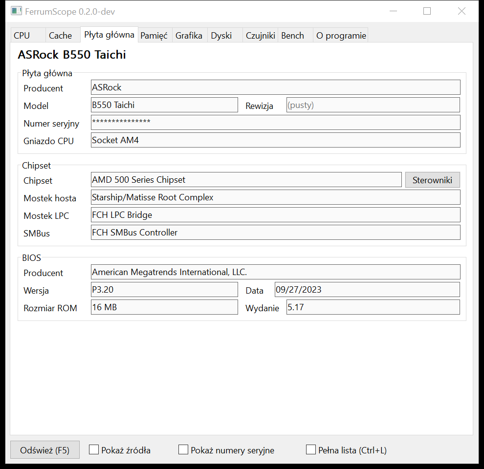

**Языки:** [English](../README.md) · [Polski](README.pl.md) · [Български](README.bg.md) · [Čeština](README.cs.md) · [Dansk](README.da.md) · [Deutsch](README.de.md) · [Ελληνικά](README.el.md) · [Español](README.es.md) · [Eesti](README.et.md) · [Suomi](README.fi.md) · [Français](README.fr.md) · [Hrvatski](README.hr.md) · [Magyar](README.hu.md) · [Italiano](README.it.md) · [Lietuvių](README.lt.md) · [Latviešu](README.lv.md) · [Norsk bokmål](README.nb.md) · [Nederlands](README.nl.md) · [Português (Brasil)](README.pt-BR.md) · [Română](README.ro.md) · [Русский](README.ru.md) · [Slovenčina](README.sk.md) · [Slovenščina](README.sl.md) · [Srpski](README.sr-Latn.md) · [Svenska](README.sv.md) · [Türkçe](README.tr.md) · [Українська](README.uk.md)

# FerrumScope

[](https://github.com/snakex21/FerrumScope/actions/workflows/ci.yml) [](../LICENSE) [](../build.zig.zon) [](#сборка)

Открытый и прозрачный инструмент для просмотра сведений об оборудовании в Windows — «CPU-Z + GPU-Z в одном», написанный на Zig. Для каждого значения показано, **откуда оно взялось** (лист CPUID, смещение SMBIOS, база идентификаторов PCI, байт журнала NVMe, библиотека производителя…) и **насколько программа в нём уверена**. Для основных функций драйвер не нужен, телеметрии нет.


## Содержание

- [Возможности](#возможности)
- [Снимки экрана](#снимки-экрана)
- [Язык интерфейса](#язык-интерфейса)
- [Что требует драйвера или прав администратора](#что-требует-драйвера-или-прав-администратора)
- [Сборка](#сборка)
- [GUI](#gui)
- [Командная строка](#командная-строка)
- [Ссылки для поиска](#ссылки-для-поиска)
- [Обновления](#обновления)
- [Capture и replay](#capture-и-replay)
- [Модель безопасности](#модель-безопасности)
- [Источники данных и лицензии](#источники-данных-и-лицензии)

## Возможности

- **CPU** — идентификация по CPUID плюс база данных оборудования с отслеживаемым происхождением записей (кодовое имя, микроархитектура, ревизия, сокет), family/model/stepping, полный список наборов инструкций (MMX … AVX-512, AES, SHA, VT-x/AMD-V) с листом и битом CPUID для каждой, выведенный уровень x86-64, кэши в виде `8 x 32 KB`, топология, а также оценка частоты **без драйвера** с нагрузкой по каждому ядру и общей.
- **Материнская плата** — производитель, модель, ревизия и BIOS (SMBIOS типы 0/1/2/3/4), чипсет, определённый по идентификаторам PCI, и все устройства PCI с именами из встроенного `pci.ids`.
- **Память** — модули из SMBIOS типа 17 (слот, объём, DDR4/DDR5, скорость и настроенная скорость, производитель, партномер, ранг, напряжение), общий объём и чётко помеченная эвристика каналов.
- **Графика** — DXGI и SetupAPI: имена, идентификаторы vendor/device/subsystem/revision, имя платы из `pci.ids`, версия и дата драйвера, выделенная и общая память, канал PCIe. Частоты, температуры, вентилятор, нагрузка и мощность берутся из **AMD ADL** или **NVIDIA NVAPI**, которые загружаются во время работы, только для чтения и необязательно.
- **Накопители** — модель, прошивка, шина, объём и серийный номер (скрыт). Журнал состояния NVMe без прав администратора, SATA SMART — от имени администратора: температура, часы работы, износ и явно указанное правило оценки состояния.
- **Датчики** — нагрузка и частота CPU, датчики GPU, температуры дисков. Датчики CPU на основе MSR — через необязательный драйвер; вентиляторы материнской платы помечены как *требует драйвера (запланировано)*.
- **Экспорт отчёта** — TXT, HTML и JSON. Серийные номера и UUID **по умолчанию скрыты**.
- **Два представления** — компактное представление в стиле CPU-Z (по умолчанию) и полный список с источником и достоверностью каждого поля (`Ctrl+L`).
- **27 языков интерфейса**, **средство обновления** со стабильным и тестовым каналами, кнопки **поиска** в базе TechPowerUp и на страницах драйверов производителей.

## Снимки экрана

| CPU | Графика |
|---|---|
|  |  |

| Материнская плата | Память |
|---|---|
|  |  |

| Накопители (администратор, SATA SMART) | Представление полного списка |
|---|---|
|  |  |

Все вкладки и оба представления: [docs/screenshots](../docs/screenshots).

## Язык интерфейса

GUI, командная строка и отчёты TXT/HTML доступны на 27 языках: польском (исходный), английском, болгарском, чешском, датском, немецком, греческом, испанском, эстонском, финском, французском, хорватском, венгерском, итальянском, литовском, латышском, норвежском (букмол), нидерландском, португальском (Бразилия), румынском, русском, словацком, словенском, сербском (латиница), шведском, турецком и украинском.

Язык выбирается в таком порядке: сохранённая настройка (`data\settings.ini`), язык интерфейса Windows, затем английский. Изменить его можно в GUI (выбор языка) или командой `ferrumscope lang <code>` / `--lang=<code>`. Технические значения (имена инструкций, единицы, идентификаторы PCI) никогда не переводятся, а ключи экспорта JSON остаются на английском. Переводчикам: см. [locales/README.md](../locales/README.md).

## Что требует драйвера или прав администратора

| Данные | Требование |
|---|---|
| CPU, материнская плата, память, графика, состояние NVMe, дескрипторы дисков | ничего (обычный пользователь) |
| SATA SMART | запуск от имени администратора; без этого программа сообщает об этом и продолжает работать |
| APERF/MPERF, температуры из MSR | драйвер `FerrumScopeMsr.sys` — **не устанавливается автоматически** |
| Вентиляторы/напряжения материнской платы (Super I/O), тайминги SPD (SMBus) | драйвер ядра — **запланировано, не реализовано** |

## Сборка

Нужен только закреплённый Zig 0.15.2.

```sh
python tools/fetch_zig.py                         # downloads Zig 0.15.2 and verifies its SHA-256
tools/zig/zig-x86_64-windows-0.15.2/zig build     # zig-out/bin/ferrumscope.exe + ferrumscope-gui.exe
tools/zig/zig-x86_64-windows-0.15.2/zig build test
tools/zig/zig-x86_64-windows-0.15.2/zig build -Doptimize=ReleaseSafe
```

`ferrumscope-gui.bat` собирает и запускает GUI. Необязательный драйвер собирается отдельно с помощью WDK (`driver/build_driver.bat`) и никогда не устанавливается при сборке.

## GUI

- Вкладки: CPU, Кэш, Материнская плата, Память, Графика, Накопители, Датчики, Тест (заглушка), О программе.
- Наведите курсор на значение, чтобы увидеть его источник, достоверность и сырое значение. **Показать источники** добавляет небольшую метку рядом с каждым полем.
- **Полный список** (`Ctrl+L`) показывает каждое поле с его источником; выбор запоминается. `F5` обновляет статические данные (SMBIOS, PCI, диски).
- **Значок/логотип** на вкладках CPU и Графика. Приоритет: ваше собственное изображение → встроенный логотип производителя → значок, нарисованный FerrumScope. Положите собственные файлы PNG рядом с программой в `data\images\`:
  - CPU: `cpu\<vendor>-<series>-<model>.png` → `cpu\<vendor>-<series>.png` → `cpu\<vendor>.png` (напр. `cpu\amd-ryzen-7-5800x3d.png`)
  - GPU: `gpu\<vid>-<did>.png` (напр. `gpu\1002-744c.png`) → `gpu\<vendor>-<series>-<model>.png` → `gpu\<vendor>-<series>.png` → `gpu\<vendor>.png`

  Имена пишутся строчными буквами, а каждый символ, не являющийся буквой или цифрой, заменяется на `-`. Щелчок по значку открывает ссылку для поиска.
- Параметры командной строки: `--tab=cpu|caches|board|memory|graphics|storage|sensors|bench|about`, `--list`, `--structured`, `--lang=<code>`.

## Командная строка

```sh
ferrumscope cpu [--json|--raw|--explain]
ferrumscope board | memory | gpu | storage | sensors-all
ferrumscope report --format=html -o report.html           # txt | html | json
ferrumscope report --format=json --include-serials        # serial numbers only on request
ferrumscope report --sys-replay db/fixtures/sys/asrock_b550_5800x3d_rx7900xtx.sysimg \
                   --cpu-replay db/fixtures/amd_ryzen7_5800x3d_native.cpuimg
ferrumscope capture cpu.cpuimg                            # raw CPUID
ferrumscope capture-sys system.sysimg [--include-serials] # raw SMBIOS/PCI/GPU/disks
ferrumscope update --check [--channel=stable|test]
ferrumscope lang [<code>]
ferrumscope sensors                                       # MSR telemetry (needs the driver)
```

## Ссылки для поиска

Кнопки **Найти** и значок открывают базу GPU/CPU TechPowerUp. Если точная страница известна, используется именно она, в таком порядке:

1. ссылка, которую вы закрепили сами — скопируйте адрес страницы в браузере и нажмите **Закрепить…** рядом с полем (сохраняется в `data\links.toml`);
2. курируемая таблица [`db/source/links/techpowerup.toml`](../db/source/links/techpowerup.toml) — записи добавляются вручную (`source = "manual"`), никогда автоматическим обходом сайта; pull request’ы приветствуются;
3. иначе — поиск по имени.

Хранятся только ссылки; с TechPowerUp ничего не загружается. Допустимые адреса: `https://` на techpowerup.com или на сайте производителя.

## Обновления

FerrumScope проверяет выпуски GitHub `snakex21/FerrumScope` по HTTPS — не чаще одного раза в день при запуске (можно отключить) или по запросу в **О программе → Проверить обновления** / `ferrumscope update --check`. Обновление устанавливается только тогда, когда загруженный zip-архив совпадает с **обеими** суммами SHA-256: в `ferrumscope-update.json` и в `SHA256SUMS`; предыдущий exe сохраняется как `.old` (`ferrumscope update --rollback`), а папка `data\` (настройки, закреплённые ссылки, ваши изображения) никогда не изменяется. Каналы: **стабильный** (по умолчанию) и **тестовый** (предварительные выпуски). Никакая телеметрия не отправляется.

## Capture и replay

`.cpuimg` хранит сырые листья CPUID; `.sysimg` хранит сырые данные SMBIOS, идентификаторы PCI, адаптеры DXGI и дескрипторы дисков/страницы NVMe/SMART. Оба — текстовые файлы, и они проходят через **те же декодеры**, что и живые данные, поэтому парсеры тестируются без оборудования. `capture-sys` по умолчанию скрывает серийные номера и UUID SMBIOS (смещения остаются корректными). Формат: [docs/04-fcap-i-testy.md](../docs/04-fcap-i-testy.md).

## Модель безопасности

- GUI и CLI работают от имени обычного пользователя; ничего не устанавливается.
- Необязательный драйвер `FerrumScopeMsr.sys` работает **только на чтение**: три IOCTL, **список разрешённых** MSR (APERF/MPERF), каждый запрос проверяется в ядре, доступ к устройству ограничен группами SYSTEM и Administrators (`IoCreateDeviceSecure`), пути записи нет вообще. На реальной системе он ещё не загружался. Подробнее: [docs/SECURITY-MODEL.md](../docs/SECURITY-MODEL.md).
- Диски получают только команды чтения (IOCTL запросов к хранилищу, NVMe Get Log Page 02h, ATA SMART READ DATA/THRESHOLDS).
- Библиотеки GPU производителей загружаются только из System32, и используются только функции запроса.
- Серийные номера скрываются в GUI, отчётах и файлах capture, если вы явно не попросите их показать.

## Источники данных и лицензии

- Исходный код FerrumScope: **GPL-3.0-or-later** ([LICENSE](../LICENSE), [NOTICE.md](../NOTICE.md)).
- `db/source/pci/pci.ids`: PCI ID Repository, GPL-2.0-or-later **или** BSD-3-Clause.
- База CPU (`db/source/cpu/*.toml`): каждая запись ссылается на свой источник (AMD revision guides, диапазоны моделей из ядра Linux, публичные дампы CPUID). Никаких данных из CPU-Z или GPU-Z — см. [reference/README.md](../reference/README.md).
- `assets/logos/` **не** подпадает под действие GPL. AMD, Ryzen, Threadripper, EPYC, Radeon, Intel, Core, Xeon, NVIDIA и GeForce являются товарными знаками соответствующих владельцев; логотипы используются только для идентификации оборудования и не подразумевают никакого одобрения. Происхождение каждого файла: [assets/logos/SOURCES.md](../assets/logos/SOURCES.md).
- Ссылки на TechPowerUp — это обычные ссылки, которые открываете вы; никакие данные TechPowerUp не загружаются и не хранятся.
